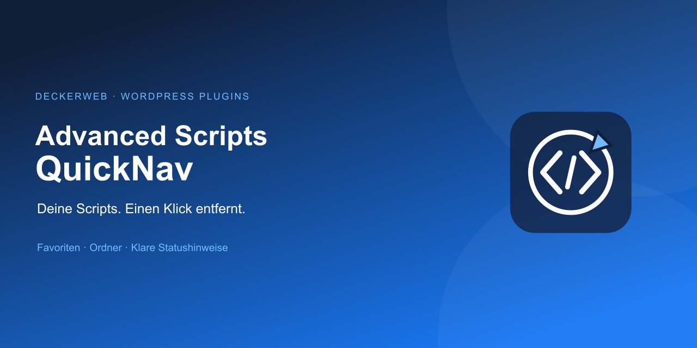

# Advanced Scripts QuickNav



**Deine Scripts. Einen Klick entfernt.** Greife direkt aus der WordPress-Toolbar auf persönliche Favoriten, Statuslisten und Scripts im Ordnerbaum zu. Ein schlankes Add-on für Advanced Scripts.

**Version:** 1.3.0 · **WordPress:** 6.7+ · **PHP:** 8.0+ · **GPL-2.0-or-later**

[English](README.md) · [Anleitung und vollständige FAQ](docs/wiki/Deutsch.md) · [GitHub](https://github.com/deckerweb/advanced-scripts-quicknav)

[Plugin-ZIP herunterladen](https://github.com/deckerweb/advanced-scripts-quicknav/releases/latest/download/advanced-scripts-quicknav.zip) · [Releases](https://github.com/deckerweb/advanced-scripts-quicknav/releases)

## Inhaltsverzeichnis

- [Auf einen Blick](#section-0)
- [Installation](#section-1)
- [Updates und Library](#section-2)
- [Konfiguration](#section-3)
- [Häufige Fragen](#section-4)
- [Changelog](#section-5)
- [Über das Plugin](#section-6)

<a id="section-0"></a>

## Auf einen Blick

### Deine Scripts direkt in der Toolbar

Erreiche Advanced Scripts überall dort, wo die WordPress-Toolbar verfügbar ist, und öffne Scripts direkt im Editor.

### Aktive Scripts, inaktive Scripts und Ordner im Blick

Navigiere über getrennte Statuslisten und den Ordnerbaum schnell zum passenden Script.

### Deine Favoriten. Dein Schnellzugriff.

Stelle häufig benötigte Scripts persönlich zusammen, öffne sie über die Toolbar und füge Favoriten direkt an Suchtreffern hinzu oder entferne sie dort.

### Alle Ordner durchsuchen. Gezielt finden.

**Die Suche, die Advanced Scripts bisher fehlt.** Finde Scripts über alle Ordner hinweg und grenze die Treffer nach Typ und Aktivstatus ein. Weniger Zeit mit Suchen verbringen, schneller am richtigen Script weiterarbeiten. Probiere es gleich aus!

### Ergänzend dazu

- **Die Script-Sammlung auf einen Blick:** Eine übersichtliche Statistik zeigt aktive und inaktive Snippets, Script-Typen und Ordnerblockaden.
- **So arbeiten, wie es zu dir passt:** Persönliche Anzeigeoptionen, Script-Zähler und begrenzte Menülisten gelten pro Benutzer und Website.

<a id="section-1"></a>

## Installation

1. Lade das Release-ZIP hoch: Plugins → Plugin hinzufügen → Plugin hochladen.
2. Aktiviere Advanced Scripts und QuickNav.
3. Öffne Einstellungen → Advanced Scripts QuickNav und wähle Favoriten.
4. Speichere deine Einstellungen und öffne Scripts in der Toolbar.

Deaktiviere ein bisher verwendetes eigenständiges QuickNav-Snippet vor der Plugin-Aktivierung.

<a id="section-2"></a>

## Updates und Library

Der deckerweb GitHub Updater V2 zeigt öffentliche stabile Releases im regulären WordPress-Updatesystem an. Für die Erstinstallation das Release-ZIP hochladen. Die deckerweb Library ergänzt den deckerweb-Tab im Plugin-Installer und eigene gemeinsame Einstellungen. Sie ist unabhängig von Snippets finden.

Header und Footer der Einstellungsseite zeigen Icon, Version, sprachabhängige Dokumentation, den als HTML formatierten lokalen Changelog, Plugin-Website und © 2025–2026 David Decker – DECKERWEB.

<a id="section-3"></a>

## Konfiguration

Konstanten haben Vorrang vor persönlichen Anzeigeoptionen. Benutzer benötigen manage_options und die konfigurierte QuickNav-Berechtigung. Der Ordnerbaum enthält maximal acht Ebenen und standardmäßig 40 Script-/Ordnereinträge insgesamt. Favoriten und jede Statusliste sind ebenfalls auf je 40 Einträge begrenzt. Alle anzeigen öffnet Advanced Scripts.

Beispiele, bei Bedarf einzeln verwenden:

```php
define( 'ASQN_VIEW_CAPABILITY', 'activate_plugins' );
define( 'ASQN_ENABLED_USERS', [ 1, 500 ] );
define( 'ASQN_NAME_IN_ADMINBAR', 'Scripts' );
define( 'ASQN_COUNTER', 'yes' );
define( 'ASQN_ICON', 'remix' );
define( 'ASQN_DISABLE_LIBRARY', 'yes' );
define( 'ASQN_DISABLE_FOOTER', 'yes' );
define( 'ASQN_EXPERT_MODE', false );
define( 'ASQN_MENU_LIMIT', 40 );
```

ASQN_ICON akzeptiert blue oder remix; ohne Konstante erscheint das QuickNav-Symbol. ASQN_DISABLE_LIBRARY steuert nur Ressourcenlinks. Die deckerweb Library hat eigene Einstellungen.

<a id="section-4"></a>


## Globale Script-Suche

Die Filter **Script-Typ** und **Script-Status** lassen sich miteinander und mit dem Suchtext kombinieren; auch ohne Suchtext sind sie nutzbar. **Aktiv** bezieht sich auf den gespeicherten Status und kann durch Ordner blockierte Scripts enthalten. Der eigene Filter **Aktiv, durch Ordner blockiert** zeigt nur diese Fälle. Über den Stern am Treffer werden persönliche Favoriten sofort gespeichert, maximal 100 pro Benutzer und Website. Die Toolbar übernimmt die Änderung beim nächsten Seitenaufruf.


Unter **Werkzeuge → Advanced Scripts** ergänzt QuickNav oberhalb der Script-Liste das Feld **Alle Scripts durchsuchen**. Es findet Scripts anhand von Titel und Ordnerpfad in allen Ordnern. Mehrere Suchwörter werden gemeinsam berücksichtigt; Groß-/Kleinschreibung und Akzente werden ignoriert. Treffer zeigen Typ, gespeicherten Aktivstatus und Ordnerpfad. Ein Klick öffnet das Script direkt im zugehörigen Ordner.

**Esc** oder **Suche zurücksetzen** stellt die ursprüngliche Liste wieder her. Mit **Pfeil nach unten** geht der Fokus vom Suchfeld zum ersten Treffer. Angezeigt werden bis zu 50 Treffer; bei mehr Treffern lässt sich die Suche weiter eingrenzen. Script-Quellcode wird weder durchsucht noch übertragen. Die Suche verwendet deine bestehenden QuickNav-Berechtigungen und verändert keine Dateien oder Einstellungen von Advanced Scripts.

## Häufige Fragen

### Für wen ist QuickNav gedacht?

Für Administratoren, die häufig mit Advanced Scripts arbeiten und aus der Backend- oder Frontend-Toolbar direkt auf Scripts zugreifen möchten.

### Wo wähle ich Favoriten aus?

Öffne Einstellungen → Advanced Scripts QuickNav. Sieh klickbare Favoritenkarten und die Snippet-Statistik, filtere nach Titel oder Ordner, wähle Scripts und speichere deine Einstellungen.

### Was bedeutet Durch Ordner deaktiviert?

Mindestens ein übergeordneter Ordner ist inaktiv. Advanced Scripts überspringt diesen Zweig auch dann, wenn das Script selbst aktiv ist.

### Bedeutet Aktiv, dass ein Script gerade ausgeführt wird?

Nein. Gemeint ist der gespeicherte Script-Status. Ordnerstatus, Ausführungsort, Bedingungen, Hooks und PHP-Safe-Mode können die Ausführung beeinflussen.

### Wie erkennt QuickNav den Safe Mode?

Eine definierte Konstante AS_SAFE_MODE hat Vorrang, auch mit false. Andernfalls liest QuickNav die Option advanced-scripts-safemode. Es verändert den Safe Mode nicht.

### Wie funktionieren Updates?

Das Plugin integriert deckerweb GitHub Updater V2 in das reguläre WordPress-Updatesystem. Er prüft öffentliche stabile GitHub-Releases und stellt das passende Plugin-ZIP bereit. Automatische Updates werden nicht eingeschaltet.

[Alle Fragen nach Themen](docs/wiki/Deutsch.md)

<a id="section-5"></a>

## Changelog

### 1.3.0 · 2026-10-19

- **Neu:** Native WordPress-Befehlspalette mit Script-Verwaltung, neuem Script, Suche, QuickNav-Einstellungen und persönlichen Favoriten.
- **Neu:** Globale Suche nach Script-Titel und Ordnerpfad direkt in Advanced Scripts, mit Typ-/Statusfiltern und Tastaturbedienung.
- **Neu:** Persönliche Favoriten direkt an den Suchtreffern hinzufügen oder entfernen, ohne die Einstellungsseite zu öffnen.
- **Verbessert:** Die Suche fügt sich in die dunkle Advanced-Scripts-Oberfläche ein und zeigt bis zu 50 Treffer mit Gesamtzahl.
- **Verbessert:** deckerweb Library auf 1.0.0 aktualisiert; QuickNav bleibt bei fehlendem oder deaktiviertem Advanced Scripts aktivierbar.
- **Verbessert:** Effizientere Verarbeitung der Suchmetadaten und robustes Schließen beziehungsweise Dokumentations-Fallbacks im Changelog-Dialog.

#
- **Behoben:** Der lokale Änderungsverlauf folgt der geladenen deutschen Admin-Übersetzung auch bei abweichender Anfrage-Sprache.

## 1.2.1 · 2026-10-09

- **Verbessert:** Die Einstellungsseite zeigt einen dezenten Safe-Mode-Hinweis mit der wirksamen Quelle: AS_SAFE_MODE-Konstante oder Einstellung in Advanced Scripts.

- **Behoben:** QuickNav bleibt ohne Advanced Scripts aktiv und erreichbar; Abhängigkeitshinweise stehen außerhalb des Headers, und Speichern führt ohne Datenverlust zurück in den Admin.

- **Verbessert:** Banner verwenden die frei lizenzierte Schrift Inter; SVG-Schriftpfade sichern eine einheitliche Darstellung.

- **Verbessert:** Änderungsverlauf in den Plugin-Details verwendet native Überschriften, Listen, fette Kategorie-Labels und klickbare Links statt rohem Markdown; zeigt je nach Admin-Sprache die deutsche oder englische Fassung.

- **Verbessert:** Eingebetteten Plugin-Katalog und übersetzte Update-Meldungen aktualisiert; persönliche Einstellungen bleiben erhalten.
- **Behoben:** Prüft Paketidentität und Kompatibilität auch bei WordPress-Sammelupdates.
- **Sonstiges:** Deinstallation bereinigt temporäre Update-Daten und erhält persönliche Einstellungen sowie Advanced-Scripts-Inhalte.

### 1.2.0 · 2026-10-01

- **Neu:** Persönliche Favoriten mit klickbaren Karten, direkter Auswahlvorschau und Filter nach Titel oder Ordner.
- **Neu:** Snippet-Statistik, Script-Links im Ordnerbaum und die Aktion Script hier hinzufügen.
- **Verbessert:** Gemeinsamer deckerweb GitHub Updater V2, deckerweb Library, Einstellungs-Header/-Footer und zugänglicher HTML-Changelog-Dialog.
- **Verbessert:** Code-Compass-Grafiken sowie abgestimmte deutsche/englische Dokumentation, FAQs und Übersetzungen.
- **Behoben:** Safe-Mode-Erkennung, Verarbeitung der Link-Filter, Menü-IDs, Sichtbarkeitsoptionen und der veraltete Toolbar-Callback, der in rc2 einen Fatal Error verursachte.

- **Sonstiges:** Benötigt PHP 8.0 oder neuer; persönliche Einstellungen bleiben erhalten.

### 1.1.0 · 2025-04-05

- **Neu:** Beschränkt QuickNav optional mit ASQN_ENABLED_USERS auf festgelegte Benutzer-IDs.
- **Verbessert:** Unterstützt Installation und Aktualisierung mit Git Updater.
- **Behoben:** Behebt eine PHP-Warnung im Frontend.

## Über das Plugin

Ein unabhängiges Add-on von David Decker – DECKERWEB. Advanced Scripts wird von Clean Plugins entwickelt. QuickNav enthält keinen Premium-Quellcode von Advanced Scripts.

[Projekt unterstützen](https://ko-fi.com/deckerweb) · [Newsletter](https://eepurl.com/gbAUUn) · [Advanced Scripts kaufen (Affiliate-Link)](https://r.freemius.com/6334/142255/)

GPL v2 oder höher. Neue QuickNav-Grafiken: © 2026 David Decker – DECKERWEB. Vorhandene Drittanbieter-Icons behalten ihre Urheberzuordnung.

## Hilfe und Sicherheit

[Issues](https://github.com/deckerweb/advanced-scripts-quicknav/issues) · [Vertrauliche Sicherheitsmeldungen](SECURITY-de.md)

[Komponenten, Lizenzen und Daten](docs/DATA-de.md)

## WordPress-Befehlspalette

Nutze die native WordPress-Befehlspalette: Script-Verwaltung öffnen, neues Script anlegen, globale Suche fokussieren, QuickNav-Einstellungen aufrufen oder direkt zu persönlichen Favoriten springen. Die Befehle beachten die QuickNav-Berechtigungen und die aktuelle Website; Favoritenbefehle verwenden das eingestellte Eintragslimit. Sie erscheinen dort, wo WordPress seine native Palette bereitstellt (bei älteren unterstützten Versionen im Blockeditor). Fehlt Advanced Scripts, bleiben die QuickNav-Einstellungen erreichbar. Dateien von Advanced Scripts werden nicht verändert.
