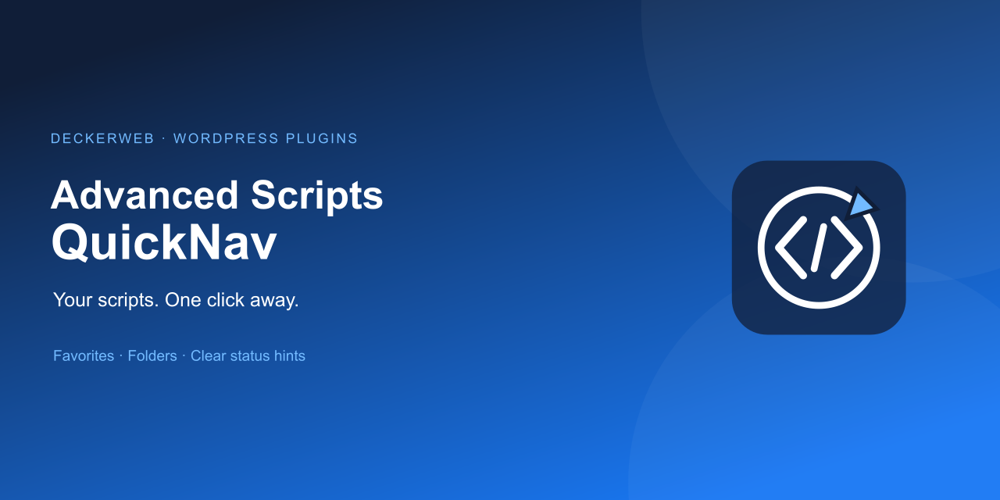

# Advanced Scripts QuickNav



**Your scripts. One click away.** Reach personal favorites, status lists and scripts inside folders directly from the WordPress toolbar. A focused add-on for Advanced Scripts.

**Version:** 1.2.1-rc1 · **WordPress:** 6.7+ · **PHP:** 8.0+ · **GPL-2.0-or-later**

[Deutsch](README-de.md) · [Guide and complete FAQ](docs/wiki/English.md) · [GitHub](https://github.com/deckerweb/advanced-scripts-quicknav)

[Download plugin ZIP](https://github.com/deckerweb/advanced-scripts-quicknav/releases/latest/download/advanced-scripts-quicknav.zip) · [Releases](https://github.com/deckerweb/advanced-scripts-quicknav/releases)

## Contents

- [At a glance](#section-0)
- [Installation](#section-1)
- [Updates and Library](#section-2)
- [Configuration](#section-3)
- [FAQ](#section-4)
- [Changelog](#section-5)
- [About](#section-6)

<a id="section-0"></a>

## At a glance

- Personal favorites per user and website.
- Script links in the folder tree and Add script here.
- Own activation status plus inactive-ancestor hints.
- Type, folder path, execution location and hook details.
- Visual favorite cards, snippet statistics, display preferences, Safe Mode notices, SCRIPT_DEBUG and optional developer links.
- Existing resource links and integrations with DevKit Pro, System Dashboard, Variable Inspector and Debug Log Manager remain included.

<a id="section-1"></a>

## Installation

1. Upload the release ZIP through Plugins → Add New → Upload Plugin.
2. Activate Advanced Scripts and QuickNav.
3. Open Settings → Advanced Scripts QuickNav and select favorites.
4. Save preferences and open Scripts in the toolbar.

Previously installed standalone snippets should be disabled before activating the plugin.

<a id="section-2"></a>

## Updates and Library

deckerweb GitHub Updater V2 offers public stable releases through regular WordPress updates. Install the release ZIP for the first installation. deckerweb Library adds a deckerweb tab in the plugin installer and shared settings. It is separate from Find Snippets.

The settings header/footer includes the icon, version, localized documentation, local changelog, plugin website and © 2025–2026 David Decker – DECKERWEB.

<a id="section-3"></a>

## Configuration

Constants override personal display preferences. Users need manage_options and the configured QuickNav capability. The folder tree allows eight levels and defaults to 40 script/folder entries overall. Favorites and each status list also default to 40 entries. View all opens Advanced Scripts.

Examples; apply individually as needed:

```php
define( 'ASQN_VIEW_CAPABILITY', 'activate_plugins' );
define( 'ASQN_ENABLED_USERS', [ 1, 500 ] );
define( 'ASQN_NAME_IN_ADMINBAR', 'Scripts' );
define( 'ASQN_COUNTER', 'yes' );
define( 'ASQN_ICON', 'remix' );
define( 'ASQN_DISABLE_LIBRARY', 'yes' );
define( 'ASQN_DISABLE_FOOTER', 'yes' );
define( 'ASQN_EXPERT_MODE', false );
define( 'ASQN_MENU_LIMIT', 40 );
```

ASQN_ICON accepts blue or remix; without a constant the QuickNav symbol is used. ASQN_DISABLE_LIBRARY controls resource links only. deckerweb Library has its own settings.

<a id="section-4"></a>

## FAQ

### Who is QuickNav for?

Administrators who frequently use Advanced Scripts and want direct access from the backend and frontend toolbar.

### Where do I select favorites?

Open Settings → Advanced Scripts QuickNav. See clickable favorite cards and snippet statistics, filter by title or folder, select scripts and save your preferences.

### What does Disabled by folder mean?

The script has at least one inactive ancestor folder. Advanced Scripts skips that branch even if the script itself is active.

### Does Active mean currently running?

No. It is the saved script flag. Folder status, execution location, conditions, hooks and PHP Safe Mode can affect execution.

### How does Safe Mode detection work?

A defined AS_SAFE_MODE takes precedence, including false. Otherwise QuickNav reads the advanced-scripts-safemode option. It does not change Safe Mode.

### How do updates work?

The plugin integrates deckerweb GitHub Updater V2 with the regular WordPress update system. It checks public stable GitHub releases and provides the matching plugin ZIP. It does not enable automatic updates.

[Complete FAQ by topic](docs/wiki/English.md)

<a id="section-5"></a>

## Changelog


### 1.2.1-rc1 · 2026-10-01

- **Improved:** Plugin-details changelog uses native headings, lists, bold category labels and clickable links instead of raw Markdown; selects German or English release notes for the administrator.

- **Improved:** Updated the embedded plugin catalog and localized update messages; personal settings remain intact.
- **Fixed:** Enforces package identity and compatibility checks during WordPress bulk updates.
- **Misc:** Uninstall clears temporary update data while preserving personal preferences and Advanced Scripts contents.


### 1.2.0 · 2026-10-01

- **New:** Personal favorites with clickable cards, a live selection preview and filtering by title or folder.
- **New:** Snippet statistics, folder-tree script links and an Add script here shortcut.
- **Improved:** Shared deckerweb GitHub Updater V2, deckerweb Library, settings header/footer and an accessible HTML changelog dialog.
- **Improved:** Code Compass artwork and synchronized English/German documentation, FAQs and translations.
- **Fixed:** Safe Mode detection, link-filter handling, menu IDs, visibility controls and the obsolete toolbar callback that caused a fatal error in rc2.

- **Misc:** Requires PHP 8.0 or newer; personal preferences remain intact.

### 1.2.0-rc3 · 2026-10-01 (test candidate)

- **Fixed:** Removed the remaining admin_bar_menu registration for the deleted remove_adminbar_nodes method, preventing a fatal error when expert links are enabled.

### 1.2.0-rc2 · 2026-10-01 (test candidate)

- **New:** Visual favorites cards with direct editor links and a live preview of the current selection.
- **New:** A compact snippet overview with totals, active/inactive counts, folders, saved favorites, active snippets blocked by folders and a type breakdown.
- **Improved:** Formats the local changelog dialog as escaped HTML with version/date headings, readable lists and subtle category badges, following the shared deckerweb footer standard.
- **Improved:** Keeps the selected Code Compass artwork (variant A) and updates synchronized English/German documentation and translations.
- **Misc:** Removes the fullscreen block-editor preference, hooks, CSS adjustments and WordPress-logo removal.

### 1.2.0-rc1 · 2026-10-01 (test candidate)

- **New:** Personal favorites stored separately for each user and website, with a filter by title or folder on the preferences page.
- **New:** Direct script links in the folder tree and an Add script here shortcut for each folder.
- **New:** Personal preferences for script counts, developer links, fullscreen toolbar and bounded menu lists.
- **Improved:** Shows Disabled by folder without changing the script’s own active/inactive status; includes type, folder path, location and hook details.
- **Improved:** Adds the shared deckerweb GitHub Updater V2, localized update artwork and embedded deckerweb Library 0.2.0.
- **Improved:** Adds the deckerweb settings header/footer and an accessible local changelog dialog.
- **Fixed:** Recognizes Safe Mode enabled through the Advanced Scripts interface, respecting AS_SAFE_MODE precedence.
- **Fixed:** Applies link-filter return values, separates library/footer visibility and handles empty collections and custom admin color schemes.
- **Fixed:** Uses shared permission checks for the toolbar and fullscreen integration; protects preferences with POST, capabilities and a nonce.
- **Misc:** Requires WordPress 6.7 and PHP 8.0. Updates preserve preferences and favorites.

### 1.1.0 · 2025-04-05

- **New:** Optionally restrict QuickNav to defined user IDs with ASQN_ENABLED_USERS.
- **Improved:** Supports installation and updates with Git Updater.
- **Fixed:** Addresses a PHP warning on the frontend.

### 1.0.0 · 2025-03-24

- **New:** Initial public release with status lists, folder links, Safe Mode notices, resource links, developer integrations and constants.


<a id="section-6"></a>

## About

An independent add-on by David Decker – DECKERWEB. Advanced Scripts is developed by Clean Plugins. QuickNav does not include Advanced Scripts premium source.

[Support the project](https://ko-fi.com/deckerweb) · [Newsletter](https://eepurl.com/gbAUUn) · [Buy Advanced Scripts (affiliate link)](https://r.freemius.com/6334/142255/)

GPL v2 or later. New QuickNav artwork: © 2026 David Decker – DECKERWEB. Existing third-party icons retain their attribution.

## Support and security

[Issues](https://github.com/deckerweb/advanced-scripts-quicknav/issues) · [Private security reporting](SECURITY.md)

[Component licenses and data](docs/DATA.md)
